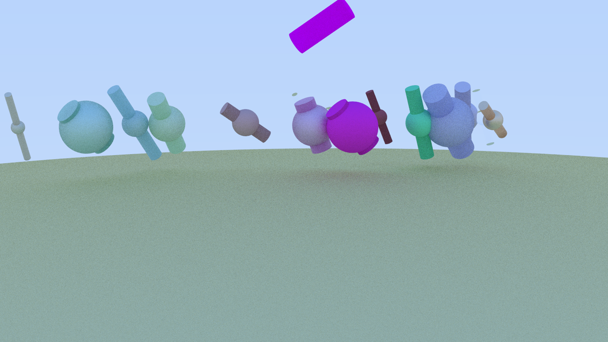
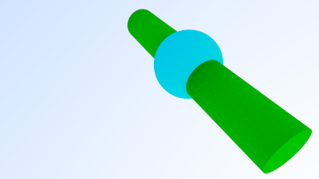
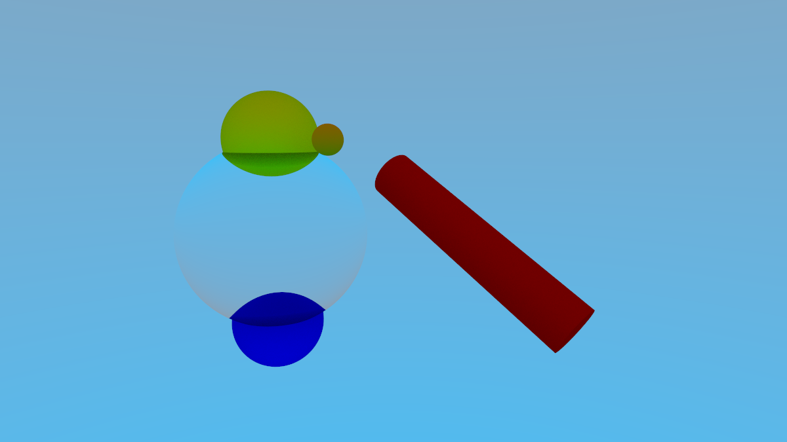

# C++ Ray Tracer: AoS vs. SoA

A sequential ray tracer written in modern C++23. It renders scenes of spheres and cylinders with matte, metal and refractive materials, and comes in two versions: one stores the image as an **Array of Structures (AoS)**, the other as a **Structure of Arrays (SoA)**. The goal was to measure how much memory layout actually matters for performance.

Built for the Computer Architecture course at Universidad Carlos III de Madrid (2025).



| | |
|---|---|
|  |  |

## Features

- Path tracing with multiple samples per pixel, configurable bounce depth and gamma correction
- Matte (diffuse), metal (reflective) and refractive materials
- Ray–sphere and ray–cylinder intersection
- Text-based scene and camera configuration, PPM (P3) output
- Seeded random sampling, so renders are reproducible
- Two executables sharing one rendering core: `render-aos` and `render-soa`

## Results

Release build, GCC 14, single thread, one run per scene:

| Scene | Resolution | Samples / px | AoS | SoA |
|---|---|---|---|---|
| 1 | 600 × 600 | 20 | 0.23 s | 0.23 s |
| 2 | 400 × 225 | 20 | 2.8 s | 2.8 s |
| 3 | 1200 × 675 | 20 | 24.5 s | 24.6 s |
| 4 | 1800 × 1012 | 20 | 52.0 s | 52.1 s |

Both versions produce identical images, and the difference in runtime is under 1%. The bottleneck is ray–object intersection and material scattering, not writing pixels, so changing the image buffer's layout barely moves the total. To see a real gain from SoA, the layout change would need to apply to the scene geometry the intersection loop reads millions of times.

## Build and run

Requires CMake ≥ 3.30, Ninja and GCC 14. GSL and GoogleTest are fetched automatically.

```bash
cmake --preset default
cmake --build --preset gcc-release

./out/build/default/aos/Release/render-aos render-2025/config4.txt render-2025/scene4.txt out.ppm
./out/build/default/soa/Release/render-soa render-2025/config4.txt render-2025/scene4.txt out.ppm
```

Run the tests with `ctest --test-dir out/build/default -C Release`. To build with static analysis, use the `clang-tidy-release` preset.

## Project structure

```
common/      Shared core: vectors, rays, scene parsing, materials, renderer
aos/         Array-of-Structures image and render-aos entry point
soa/         Structure-of-Arrays image and render-soa entry point
utcommon/    Unit tests for the shared core
utaos/       Unit tests for the AoS image
utsoa/       Unit tests for the SoA image
render-2025/ Sample scenes, configs and reference images
```

## Engineering practices

- Compiled with `-Wall -Wextra -Werror -pedantic -Wconversion -Wsign-conversion`
- clang-tidy and clang-format enforced across the codebase
- 85 GoogleTest unit tests covering every module
- Docker devcontainer for a reproducible toolchain
- `comparacion.py` checks renders against reference images (max pixel difference and RMSE)

## Team

Lucas Ruiz Gómez · Malena Lozano · Paloma González · Javier Pastor

**My contributions:** fixed the image-noise bug in the renderer, material behaviour and cylinder height, and a division-by-zero error in `hittable`. I also led the clang-tidy compliance pass and the code cleanup in `hittable` and `scene`.
